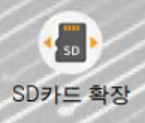
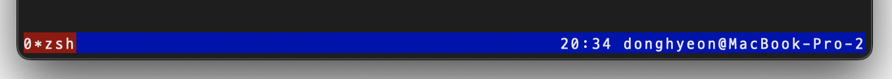

# Jenga_GPT_JPN

---

1. 始める前に…
    1. この文書は2023年6月に作成されたもので、今後APIの変更などの外部要素の変更があった場合、動作しない可能性があります。
    2. この文書に関するお問い合わせや、進行中に発生する問題についてのお問い合わせは、リポジトリのIssueを通じてお願いします。
2. 対話型AIドール Ichigoの基本概要
    1. ラズベリーパイ4B、AI MAKERS KIT、OpenAIを活用して作られた対話型AIドール。
    2. 子供が使用する愛着ドールに会話機能を追加し、子供の情緒安定に寄与することを目指します。
    3. YouTubeのAPIを活用した音楽再生、TTSエンジンを活用した童話の読み聞かせ機能で、親の育児疲れを軽減することを目指します。
3. ハードウェアの準備
    1. 必須ハードウェア
        - ラズベリーパイ 4B Rev 1.2~1.4, Rev 1.5
        - ラズベリーパイ専用ヒートシンク
            - ヒートシンクを使用しない場合、ドール内部に入れた際に高温によるスロットリングや電源オフの可能性があります。
            - (Option) ドール内部に十分なスペースがある場合、冷却ファンの使用も検討できます。
        - A1レベルの速度を持つmicroSDカード
        - AI MAKERS KIT KT GiGAGenie 人工知能教育キット
            - 下記のリンクから購入できます。
            - [https://mechasolution.com/shop/goods/goods_view.php?goodsno=582424&category=](https://mechasolution.com/shop/goods/goods_view.php?goodsno=582424&category=)
        - ラズベリーパイバッテリー電源拡張ボード
            - Jengaで使用した拡張ボードは下記の製品を使用
            - [https://www.devicemart.co.kr/goods/view?no=1383800](https://www.devicemart.co.kr/goods/view?no=1383800)
            - 上記リンクの製品のように保護回路が含まれている拡張ボードを使用する場合、18650非保護バッテリーが必要です。（国内では個人の非保護バッテリーの購入が難しいため、保護回路付きバッテリーを購入後、保護回路を取り除いて使用する必要があります。）
            - 18650バッテリーを使用する場合、偽物の購入に注意し、検証されたショッピングモールで安全性が確認されたバッテリーの購入を推奨します。（サムスン、LG、パナソニック）
            - 上記製品以外の様々なバッテリー拡張製品があるため、使用するドールのサイズに応じて他の製品も確認することを推奨します。
        - ハードウェアを収納するのに十分なスペースがあるドール
4. ハードウェアの基本セッティング
    1. ラズベリーパイのオペレーティングシステムのインストール
        - [https://aicodiny.com/download](https://aicodiny.com/download) にアクセスし、自分のラズベリーパイに合ったOSイメージをダウンロードします。
        - PCでbalenaEtcherを使用してmicroSDカードにOSをインストールします。
        - インストール完了後、ラズベリーパイにmicroSDカードを挿入します。
    2. AI コーディニーキットの組み立て
        - ドールのサイズを考慮して組み立ての可否を決定します。
            - アクリルケースが入らないほどドールのサイズが小さい場合、ケースを除いて統合ボードのみを結合することを検討できます。
        - 下記リンクを参考に組み立てを進めます
            - [https://youtu.be/cpl3jVHz8t4](https://youtu.be/cpl3jVHz8t4)
        - アクリルケースにバッテリー拡張ボードを装着
            - コーディニーキットのアクリルケースにはバッテリー装着ガイド/ホールがないため、使用するバッテリー拡張ボードに応じて好きなように装着できます。
5. オペレーティングシステムおよびソフトウェアの基本設定
    - **Warning) AI コーディニーが提供するOSは、Raspbian BusterをAI コーディニーが修正を加えたOSのため、aptを通じてパッケージのアップグレードを行う場合、AI コーディニーが修正しておいた基本設定が混乱する可能性があるため、aptを通じてパッケージのアップグレードは推奨せず、AI コーディニーが提供するアップデートのみを受けるという前提で説明します。**
    - **Warning) Pythonのバージョンは3.7バージョンを使用し、それ以外のバージョンでの正常動作は保証しません。**
    - **Warning) 他のGPIO拡張キット（タッチディスプレイなど）を使用することによって生じる問題は、ユーザーが直接解決する必要があります。**
    - **Warning) AI コーディニーが提供するOSのユーザーIDはpi、初期パスワードはkt123!@#です。**
        - **sshを使用する予定がある場合、パスワードの変更を推奨します。**
    - システムの初期化とアップデートの実行
        - 初回起動後、デスクトップの「システム初期化」アイコンをダブルクリックしてシステム初期化を実行します。
        - 初期化後、デスクトップの「AIコーディングパックアップデート」アイコンをダブルクリックしてアップデートを実行します。
    - SDカードの拡張
        - 16ギガ以上のmicroSDを使用している場合、microSDカードの全容量を使用するために拡張作業が必要です。
            
            
            
        - デスクトップの「SDカード拡張」アイコンをダブルクリックすると以下の作業は必要ありませんが、エラーが発生した場合は直接以下の手動作業を行う必要があります。
        - SDカードの手動拡張方法
            - ターミナルを開いて以下のコマンドを入力します。
                
                ```bash
                sudo raspi-config
                ```
                
            - 7 Advanced Optionsを選択 → A1 Expand Filesystem を選択 → Would you like to reboot now? というウィンドウが表示されたらYesを選択
    - **以下のプロセスからはネットワーク接続が必要です。**
    - 省電力モードをオフにする
        - xscreensaverのインストール
            
            ```bash
            sudo apt install xscreensaver
            ```
            
            - インストール後、左上のラズベリーアイコン → 設定 → Screensaver を選択
            - Mode → Disable Screen Saver に設定
    - sshの開放 (Option)
        - ラズベリーパイに直接HDMIを接続して設定する場合は必須ではありませんが、ドールに入れた状態でメンテナンスを行う場合は設定することをお勧めします。
        - 内部ネットワークでのみ使用することを想定して説明しているため、外部アクセスのためのポート開放などの設定は説明しません。
        - ターミナルを開いて以下のコマンドを入力します。
            
            ```bash
            sudo raspi-config
            ```
            
        - 5 Interfacing Options を選択 → P2 SSH を選択 → Would you like the SSH server to be enabled? というウィンドウが表示されたらYesを選択。
        - ターミナルウィンドウでifconfigを入力してwlan0のIPアドレスを確認します。
            - 接続環境によって異なる場合があります。例）RJ45 LANケーブルでインターネットに接続している場合はeth0のIPアドレスを確認する必要があります。
            - 以下の例を参考にしてください
                
                ```bash
                pi@pi:~ $ ifconfig
                eth0: # ~ 省略 ~
                lo: # ~ 省略 ~
                wlan0: # ~ 省略 ~
                			 inet 192.168.0.29 ##<<-- このIPアドレスを確認する必要があります。
                ```
                
        - Windowsからsshを通じてラズベリーパイのターミナルに接続する
            - [Putty](https://www.putty.org)を使用します。
        - Mac、Linuxからsshを通じてラズベリーパイのターミナルに接続する
            - 以下の例を参考にしてください
                
                ```bash
                # ssh username@ip.add.re.ss -p port_number
                
                kjr@byungshin$ ssh pi@192.168.0.29 -p 6974
                pi@192.168.0.29 's password: 
                # ~ 省略 ~
                pi@pi:~$
                ```
                
    - GithubからJenga_GPTリポジトリを取得する
        - ホームフォルダで以下のコマンドを入力します。
            
            ```bash
            $ git clone https://github.com/YJU-Jenga/Jenga_GPT_KOR.git && cd Jenga_GPT_KOR
            ```
            
    - Jenga_GPTの基本設定
        - Jenga_GPTフォルダで以下のコマンドを入力します。
            
            ```bash
            nano config.py
            ```
            
    - [config.py](http://config.py)に以下のようなコードを作成します。
        
        ```bash
        openai_api_key = "openai_api_key"
        youtube_api_key = "youtube_api_key"
        database_password = "database_password"
        
        db_config = {
            'host': 'localhost',
            'user': 'jenga',
            'password': 'database_password',
            'database': 'jenga',
            'charset': 'utf8',
        }
        ```
        
        - openai_api_keyとyoutube_api_key部分にユーザーが作成したAPIキーを挿入する必要があります。
        - APIの発行方法は以下の方法に従います。
            - openai_api_key発行ガイド
                
                OpenAI APIキーの発行手順は以下の通りです。
                
                1. OpenAIウェブサイトにアクセス：OpenAIの公式ウェブサイト（**[https://openai.com)に](https://openai.xn--com%29-uw20a/)**アクセスします。
                2. APIページを探す：ウェブサイトで「API」または「OpenAI API」に関連するページまたはセクションを探します。このページにはAPIキーの発行と使用に関する情報が含まれています。
                3. APIキーのリクエスト：APIページでAPIキーをリクエストするために「Get started」または「Sign up」などのボタンをクリックするか、該当ページの指示に従います。
                4. 登録/ログイン：OpenAI APIを使用するためにOpenAIに登録またはログインする必要があります。すでにOpenAIアカウントをお持ちの場合は該当アカウントでログインし、そうでない場合は新しいアカウントを作成します。
                5. 申請書の作成：API使用申請書を作成する必要があります。この申請書では、APIの使用目的や予想使用量などの情報を記入する必要があります。必要な情報を正確に記入して提出します。
                6. APIキーの発行：OpenAIは申請書を検討し承認した後、APIキーを発行します。このキーは個人的な認証情報のため、安全に保管する必要があります。
                7. APIドキュメントとガイドの確認：APIキーを発行された後、OpenAIのAPIドキュメントとガイドを確認してAPIの使用方法と機能について確認します。OpenAIはAPI使用に関する詳細なガイドと例を提供しています。
                
                **Option)** 上記の手順は概略的なガイドに過ぎず、OpenAIのポリシーや手順が変更される可能性があるため、実際の手順はOpenAIウェブサイトで確認することをお勧めします。
                
                **Option)** OpenAIの公式ドキュメントとサポートチャネルでAPIの使用に関する詳細な情報とヘルプを受けることができます。
                
            - youtube_api_key発行ガイド
                
                YouTube APIキーの発行手順は以下の通りです。
                
                1. Google Cloud Consoleにアクセス：Google Cloud Console（**[https://console.cloud.google.com)に](https://console.cloud.google.com)**）にアクセスします。
                2. プロジェクト作成：Google Cloud Consoleにログインした後、新しいプロジェクトを作成します。プロジェクト名を指定し、必要な設定を完了します。
                3. APIとサービスの有効化：作成したプロジェクトを選択し、「APIとサービス」メニューに移動します。次にYouTube Data APIを検索し、該当APIを有効化します。
                4. 認証情報の作成：「認証情報」メニューに移動して「認証情報を作成」を選択します。APIキーを選択し、必要な設定を完了します。
                5. APIキーの取得：APIキーが生成されたら、そのキーを安全な場所に保存またはコピーします。このAPIキーを使用してYouTube APIにアクセスしリクエストを送信できます。
                    
                    **Option)** 上記の手順はYouTube APIキーを発行する概略的なガイドであり、Googleのポリシーにより手順および使用方法が変更される可能性があります。
                    
                    **Option)** 実際の手順はGoogle Cloud Consoleで確認することをお勧めします。
                    
                    **Option)** Google Cloud Consoleのドキュメントとサポートチャネルは、APIキーの発行に関する詳細な情報とヘルプを提供するため、必要に応じて参照することをお勧めします。
                    
    - screenを活用してJenga_GPTをバックグラウンドで実行する準備
        1. SSHでラズベリーパイに接続します。
        2. ターミナルで次のコマンドを使用してScreenをインストールします。
            
            ```bash
            sudo apt-get install screen
            ```
            
        3. screen使用前の基本設定を行います。
            
            ```bash
            $ nano ~/.screenrc
            ```
            
            1. nanoを通じて~/.screenrcファイルに以下のスクリプトを貼り付けます。
            
            ```bash
            defscrollback 5000
            termcapinfo xterm* ti@:te@
            startup_message off
            hardstatus on
            hardstatus alwayslastline
            hardstatus string "%{.bW}%-w%{.rW}%n*%t%{-}%+w %= %c ${USER}@%H"
            bindkey -k k1 select 0
            bindkey -k k2 select 1
            bindkey -k k3 select 2
            ```
            
            1. 貼り付けが完了したら`**Ctrl + x**` → **`y`** → **`Enter`**を通じてファイルを保存します。
        4. スクリーンセッションを開始します。
            
            ```bash
            $ screen -S Jenga_GPT
            ```
            
        5. これでスクリーンセッション内で希望の作業を実行できます。上記の~/.screenrcファイルにスクリプトを追加する作業を行った場合、下の写真のようにターミナル下部に青いバーが表示され、screenに進入したことを確認できます。
            
            
            
        6. screenセッションに進入したことが確認できたら、Jenga_GPTフォルダで以下のコマンドを実行します。
        
        ```bash
        $ python3 jwt_token.py
        ```
        
        1. screenセッションをバックグラウンドに切り替えるには**`Ctrl + A + D`**を順番に押すと、screenセッションはバックグラウンドに切り替わります。
        2. screenセッションを再び取得するには以下のようなコマンドを使用します。
            
            ```bash
            $ screen -ls #<- 実行中のセッションを出力します。
            $ screen -r Jenga_GPT #<- Jenga_GPTセッションに進入します。
            ```
            
        3. スクリーンセッションを完全に終了するには、セッション内で以下のコマンドを入力します。
            
            ```bash
            exit
            ```
            
    - 上記のプロセスを通じて作成したscreenセッションでメインファイルを実行し、Jenga_GPTを実行します。
        
        ```bash
        $ python3 GPT_Kinou2.py
        ```
        
6. ドールに入れる
- ラズベリーパイとバッテリーをドール内部に入れるためには、発熱管理とショートを防ぐための配線作業に注意が必要です。以下は各作業における考慮事項です。
    1. スロットリングを防ぐための発熱管理：
        - ドール内部にラズベリーパイを入れる場合、熱が発生する可能性があるため、適切な冷却システムを構成する必要があります。そのために小型冷却ファンやSoCとRAMにヒートシンクを使用することができます。
        - 冷却ファンを使用する場合、ドールの内部構造を考慮してファンを配置し、熱が効率的に排出されるように冷却ファンの風圧と空気の流れを考慮する必要があります。
    2. 配線作業：
        - ラズベリーパイと接続されたスピーカー、マイクをドール内部で安定的に動作させるために適切な配線作業が必要です。
        - 内部ケーブルが切れて短絡や火災が起きないように配線作業を行う必要があります。
- 上記の作業は電気的安全性および発熱管理のための定期的な点検と注意が必要です。